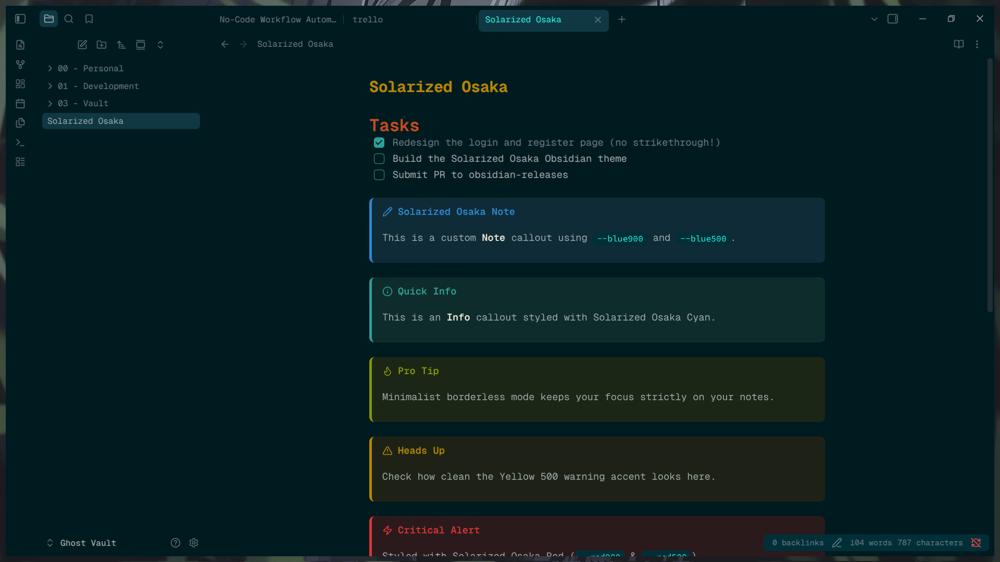

# Solarized Osaka for Obsidian

A minimalist, borderless dark and light theme for Obsidian, heavily inspired by the classic Solarized palette mixed with deep, moody Osaka teal.

## Features

- **Borderless UI:** Seamless workspace tabs, sidebars, and ribbons.
- **Custom Checkboxes:** Clean, custom-styled task boxes without text strikethrough.
- **Callout Styling:** Fully themed callouts (`note`, `info`, `warning`, `danger`, etc.) using core Solarized accent colors.
- **Modern Tables:** Rounded, separated tables with distinct hover states.
- **High Readability:** Highly optimized contrast utilizing the true Solarized palette for long writing and coding sessions.

## Installation

1. Open Obsidian **Settings** > **Appearance**.
2. Under **Themes**, click **Manage**.
3. Search for "Solarized Osaka" and click **Install and use**.

## Manual Installation

1. Download `theme.css` and `manifest.json` from the latest GitHub Release.
2. Place them in your vault's `.obsidian/themes/Solarized Osaka/` folder.
3. Select the theme in Obsidian's Appearance settings.

## License

MIT License
